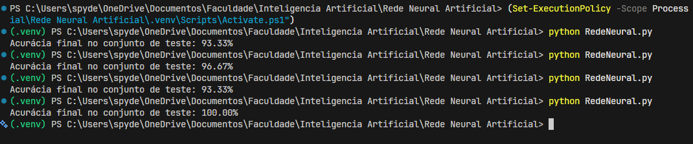

# Classificador Iris com Rede Neural em NumPy

**Aluno:** João Vicente Batista da Cunha

## 1. Objetivo
Este projeto implementa e treina uma rede neural artificial para classificar flores do conjunto de dados Iris nas espécies: *setosa*, *versicolor* e *virginica*.

É utilizado o **NumPy** para as operações matemáticas e matriciais. O **Scikit-Learn** é usado restritamente para carregar os dados, dividir os conjuntos e padronizar as características.

## 2. Arquitetura da Rede
- **Camada de Entrada:** 4 neurônios.
- **Camada Escondida:** 8 neurônios com ativação ReLU.
- **Camada de Saída:** 3 neurônios (um para cada espécie) com ativação Softmax.
- **Função de Custo:** Entropia Cruzada.
- **Otimização:** Gradiente Descendente.

## 3. Como Executar
Tenha o Python 3.10 ou superior instalado. No terminal, dentro da pasta do projeto, instale as dependências:

```bash
python -m pip install -r requirements.txt
```

Em seguida, execute o script do modelo:

```bash
python RedeNeural.py
```

## 4. Exemplo de Saída
Como a divisão dos dados de teste (20% = 30 amostras) e a inicialização dos pesos iniciais são aleatórias, a acurácia varia ligeiramente a cada execução. Abaixo está uma amostra de múltiplas execuções seguidas:



## 5. Arquivos do Projeto
- `RedeNeural.py`: Código-fonte principal contendo o pré-processamento e a implementação da rede neural.
- `requirements.txt`: Lista de bibliotecas dependentes (`numpy`, `scikit-learn`).